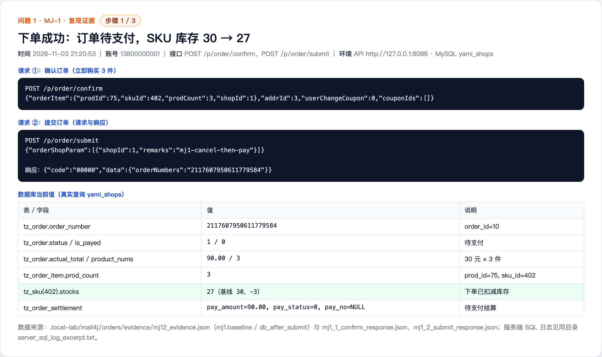
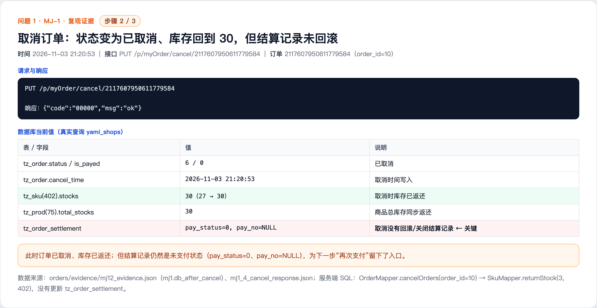
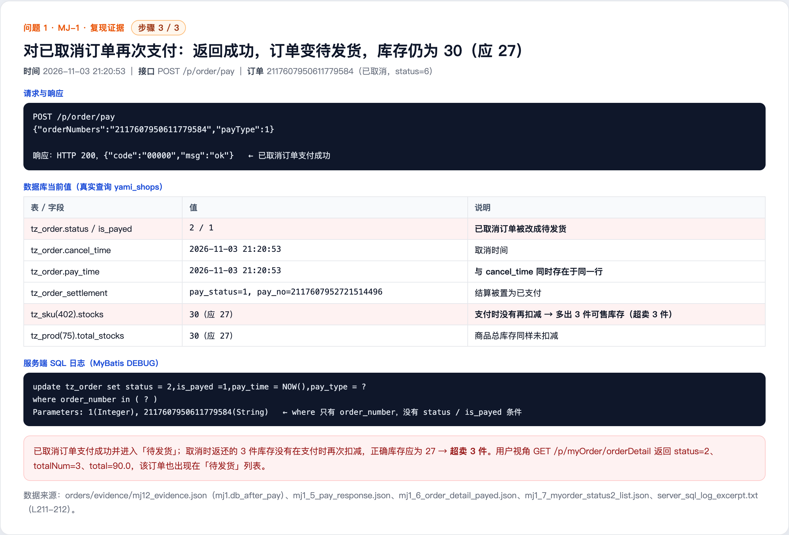

# Cancelled order can still be paid and stock is not deducted (MJ-1)

## Summary

A normal authenticated member can cancel an order (which returns the stock) and then pay the same cancelled order. The payment entry point does not validate the order status, so a payment record is created and the order is changed to the paid state. The stock is not deducted again on payment, so the same goods are sold twice and the stock is overstated.

- Affected version: mall4j current master c69b679 (2026-11-02)
- Endpoint: POST /p/order/pay
- Prerequisite: a normal member who owns the order
- Impact: overselling and an inconsistent order state machine

## Root Cause

- Cancellation only changes the order status and returns the stock; the settlement record is not closed. OrderServiceImpl.cancelOrders (OrderServiceImpl.java:109-137) calls OrderMapper.cancelOrders (OrderMapper.xml:179-184) to set the order to cancelled and then caches the stock back through SkuMapper.returnStock and ProductMapper.updateStocks. The tz_order_settlement record remains pay_status=0 and pay_no=NULL, which leaves a valid payment entry.
- PayServiceImpl.pay (PayServiceImpl.java:58-101, core checks at :77-80) only verifies that the order exists and belongs to the current user. It does not check status=waiting for payment or is_payed=0, so an order with status=6 (cancelled) can still create a payment transaction.
- PayServiceImpl.paySuccess (PayServiceImpl.java:104-129) only checks settlement.pay_status == 1 (:112). OrderMapper.updateByToPaySuccess (OrderMapper.xml:193-198) then runs update tz_order set status=2, is_payed=1, pay_time=NOW() where order_number in (...), with no order-status condition and no check on the affected row count.
- As a result, payment succeeds, the order becomes waiting for shipment, and the stock remains at the value restored by cancellation.

Code references (c69b679):

- https://github.com/gz-yami/mall4j/blob/c69b679/yami-shop-api/src/main/java/com/yami/shop/api/controller/MyOrderController.java#L127-L153 (cancel entry)
- https://github.com/gz-yami/mall4j/blob/c69b679/yami-shop-service/src/main/java/com/yami/shop/service/impl/OrderServiceImpl.java#L109-L137 (cancel and stock return)
- https://github.com/gz-yami/mall4j/blob/c69b679/yami-shop-service/src/main/resources/mapper/OrderMapper.xml#L179-L184 (cancelOrders)
- https://github.com/gz-yami/mall4j/blob/c69b679/yami-shop-service/src/main/resources/mapper/SkuMapper.xml#L53-L57 (returnStock)
- https://github.com/gz-yami/mall4j/blob/c69b679/yami-shop-api/src/main/java/com/yami/shop/api/controller/PayController.java#L42-L52 (pay entry)
- https://github.com/gz-yami/mall4j/blob/c69b679/yami-shop-service/src/main/java/com/yami/shop/service/impl/PayServiceImpl.java#L58-L101 (pay does not check order status)
- https://github.com/gz-yami/mall4j/blob/c69b679/yami-shop-service/src/main/resources/mapper/OrderSettlementMapper.xml#L19-L36 (payment does not close settlement)
- https://github.com/gz-yami/mall4j/blob/c69b679/yami-shop-service/src/main/java/com/yami/shop/service/impl/PayServiceImpl.java#L104-L129 (paySuccess only checks settlement)
- https://github.com/gz-yami/mall4j/blob/c69b679/yami-shop-service/src/main/resources/mapper/OrderMapper.xml#L193-L198 (updateByToPaySuccess without status condition)

## Reproduction

1. Prepare product 75 / SKU 402 (price 30 CNY, stock 30), member 13800000001 and address addrId=3.
2. Buy 3 units through the immediate purchase flow: POST /p/order/confirm with orderItem={prodId:75, skuId:402, prodCount:3, shopId:1} and addrId=3, then POST /p/order/submit. The order number is 2117607950611779584 (order_id=10), status=1, stock 30 -> 27.
3. Cancel the order: PUT /p/myOrder/cancel/2117607950611779584. The order becomes status=6, cancel_time is written, and stock returns to 30. The settlement record still has pay_status=0 and pay_no=NULL.
4. Pay the cancelled order: POST /p/order/pay with {"orderNumbers":"2117607950611779584","payType":1}. The API returns HTTP 200, code=00000, msg=ok.
5. Check the database: order status=2, is_payed=1, pay_time=2026-11-03 21:20:53, while cancel_time has the same value; settlement pay_status=1, pay_no=2117607952721514496; SKU stock is still 30 (correct value would be 27); product total stock is still 30.
6. The user sees the order in the waiting-for-shipment list and the order detail returns status=2, totalNum=3, total=90.0.

## Observed Result

The cancelled order was paid successfully, moved to waiting for shipment, and the stock stayed at 30 instead of 27, so 3 units were oversold.

Key database values (tz_sku.stocks for SKU 402, tz_order.status, tz_order_settlement):

- Baseline: stock 30 / 30; no order.
- After submit: order status=1, is_payed=0; settlement pay_status=0, pay_no=NULL; stock 27.
- After cancel: order status=6, cancel_time=21:20:53; settlement still pay_status=0, pay_no=NULL; stock 30.
- After pay: order status=2, is_payed=1, pay_time=21:20:53 (same as cancel_time); settlement pay_status=1, pay_no=2117607952721514496; stock still 30 (expected 27).

## Impact

- Each successful trigger creates one extra set of sellable stock, leading to overselling and a mismatch between book stock and physical stock.
- A cancelled order can be moved back to waiting for shipment, breaking the order state machine and affecting after-sales, reconciliation and statistics.
- Repeated use of cancelled orders may combine with payment and refund flows to create both financial and stock inconsistencies.

## Remediation

- In PayServiceImpl.pay, require status=waiting for payment and is_payed=0, and verify the settlement pay_status=0; reject cancelled or already-paid orders.
- Add status=1 and is_payed=0 to the WHERE clause of OrderMapper.updateByToPaySuccess and check the affected row count; roll back when 0 rows are updated.
- Close the settlement record when an order is cancelled, or re-check the order status before creating a payment transaction.
- In paySuccess, verify that each order referenced by the settlement record is still waiting for payment and has a matching amount; add idempotency and a unique successful payment constraint.

## References

- Fix status: pending vendor fix
- Report: this directory

