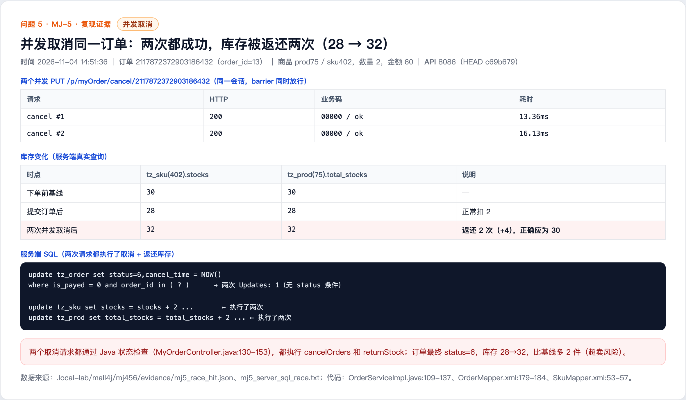

# Concurrent cancellation restores stock multiple times (MJ-5)

## Summary

Order cancellation first checks the order status in Java and then executes a close-order SQL statement that only checks is_payed=0, without a current-status condition and without checking the affected row count. Stock is restored unconditionally afterwards. Concurrent cancellation requests for the same order all pass the Java check and all restore stock, causing stock inflation.

- Affected version: mall4j current master c69b679 (2026-11-02)
- Endpoint: PUT /p/myOrder/cancel/{orderNumber}
- Prerequisite: a normal member and a waiting-for-payment order
- Impact: stock is restored multiple times and can be oversold

## Root Cause

- MyOrderController.java:127-153 checks the order status (status == UNPAY) and ownership before cancellation.
- OrderServiceImpl.java:109-137 calls OrderMapper.cancelOrders (OrderMapper.xml:179-184), whose SQL is update tz_order set status=6, cancel_time=NOW() where is_payed=0 and order_id in (...). It has no status condition and does not check the affected row count; the code then calls returnStock unconditionally.
- SkuMapper.xml:53-57 and ProductMapper.xml:84-88 restore stock without idempotency or status checks, so any caller can add stock again.

Code references (c69b679):

- https://github.com/gz-yami/mall4j/blob/c69b679/yami-shop-api/src/main/java/com/yami/shop/api/controller/MyOrderController.java#L127-L153
- https://github.com/gz-yami/mall4j/blob/c69b679/yami-shop-service/src/main/java/com/yami/shop/service/impl/OrderServiceImpl.java#L109-L137
- https://github.com/gz-yami/mall4j/blob/c69b679/yami-shop-service/src/main/resources/mapper/OrderMapper.xml#L179-L184
- https://github.com/gz-yami/mall4j/blob/c69b679/yami-shop-service/src/main/resources/mapper/SkuMapper.xml#L53-L57

## Reproduction

1. Member 13800000001 (addrId=3) orders 2 units of product 75 / SKU 402 (amount 60); stock baseline 30, stock after submission 28.
2. Send two concurrent PUT /p/myOrder/cancel/2117872372903186432 requests (same token, simultaneous release with a thread barrier).
3. Both requests return HTTP 200, code=00000, msg=ok (about 13 ms and 16 ms); the order ends at status=6 with cancel_time written.
4. Database: SKU 402 stock 28 -> 32 and product 75 total_stocks 28 -> 32, so stock was restored twice (correct value 30); 2 extra units were created.

## Observed Result

Both concurrent cancellations succeeded and stock was restored twice, creating an overselling risk.

## Impact

- Stock is restored more than once, leading to overselling; combined with MJ-1 and MJ-2 the stock and financial risk grows.
- Order status and stock become inconsistent, affecting fulfilment, refunds and reconciliation.

## Remediation

- Add a current-status condition (for example status=waiting for payment) to cancelOrders and check the affected row count; only the request that actually updates the order may restore stock.
- Make the status transition and stock restoration atomic with optimistic locking or a row lock; add idempotency control to returnStock.

## References

- Fix status: pending vendor fix
- Report: this directory

