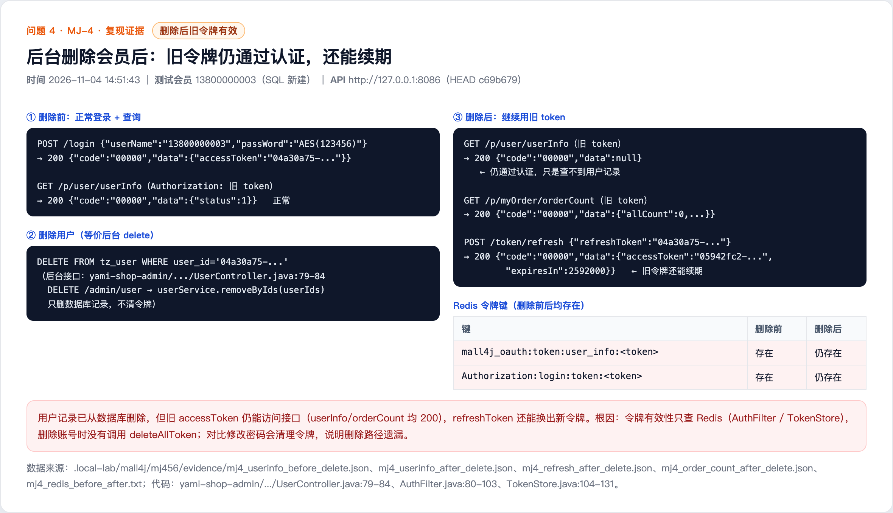

# Deleted member tokens remain valid and can be refreshed (MJ-4)

## Summary

Deleting a member only removes the database record and does not invalidate already issued access tokens or refresh tokens. Token validation reads user information from Redis and does not check whether the user still exists in the database. A deleted account can therefore keep calling APIs and can refresh its token to extend the session.

- Affected version: mall4j current master c69b679 (2026-11-02)
- Endpoint: DELETE /admin/user and the normal member APIs
- Prerequisite: a token issued before the account is deleted
- Impact: deleted accounts retain access and can extend their session

## Root Cause

- The admin member deletion endpoint only calls removeByIds: UserController.java:79-84. DELETE /admin/user calls userService.removeByIds(userIds) and does not call deleteAllToken. Password changes do clear tokens, so the deletion path is missing the same cleanup.
- AuthFilter.java:80-103 and TokenStore.java:104-131 validate a token by loading user information from Redis; they do not query the database to confirm that the user still exists.
- After deletion, Redis keys such as mall4j_oauth:token:user_info:<token>, Authorization:login:token:<token> and Authorization:login:session:0:<userId> remain present.

Code references (c69b679):

- https://github.com/gz-yami/mall4j/blob/c69b679/yami-shop-admin/src/main/java/com/yami/shop/admin/controller/UserController.java#L79-L84
- https://github.com/gz-yami/mall4j/blob/c69b679/yami-shop-sys/src/main/java/com/yami/shop/sys/controller/SysUserController.java#L183-L197
- https://github.com/gz-yami/mall4j/blob/c69b679/yami-shop-security/yami-shop-security-api/src/main/java/com/yami/shop/security/api/filter/AuthFilter.java#L80-L103
- https://github.com/gz-yami/mall4j/blob/c69b679/yami-shop-security/yami-shop-security-common/src/main/java/com/yami/shop/security/common/manager/TokenStore.java#L104-L131

## Reproduction

1. Create a test member 13800000003 with SQL (login_password='{noop}123456', status=1) and log in to obtain a token. GET /p/user/userInfo returns 200 code=00000.
2. Delete the member row (equivalent to the admin DELETE /admin/user path, which calls removeByIds): DELETE FROM tz_user WHERE user_id=<member id>.
3. Continue using the old token: GET /p/user/userInfo returns HTTP 200 code=00000 (data=null); GET /p/myOrder/orderCount returns 200.
4. POST /token/refresh still returns a new accessToken with expiresIn=2592000.
5. The Redis keys listed above exist both before and after deletion; no token is removed.

## Observed Result

The user record is deleted, but the old token still passes authentication and can access APIs, and the refresh token can still issue a new access token.

## Impact

- Deleted members or admin accounts can continue to access the system until the token expires.
- The refresh token allows the session to be extended after deletion, so deletion does not take effect immediately.

## Remediation

- Call deleteAllToken (or equivalent) when deleting members and admin accounts to revoke all access tokens, refresh tokens and sessions.
- Check that the user exists and is enabled during token validation; reject tokens of deleted or disabled accounts.
- Also check account status during refresh-token processing.

## References

- Fix status: pending vendor fix
- Report: this directory

