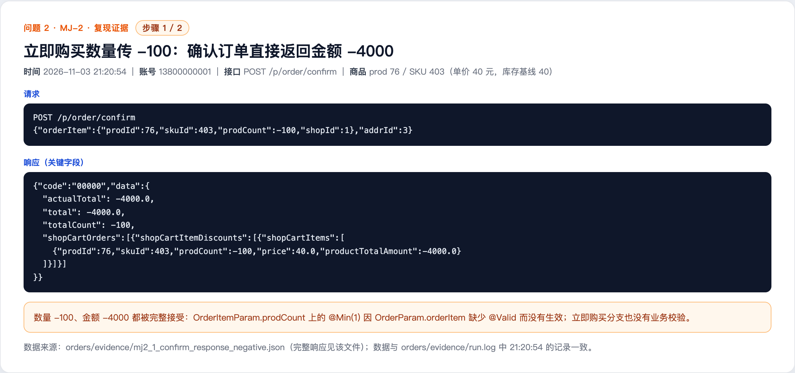
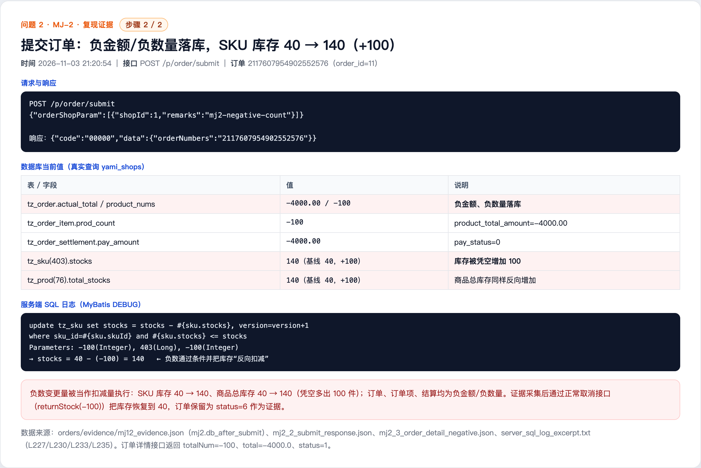

# Negative quantity in immediate purchase increases stock (MJ-2)

## Summary

The immediate purchase path accepts a negative product quantity. Because nested validation is missing, the order amount becomes negative and the stock deduction statement adds the absolute value back to the stock. A normal member can therefore create a negative-value order and inflate the stock of any SKU.

- Affected version: mall4j current master c69b679 (2026-11-02)
- Endpoint: POST /p/order/confirm and POST /p/order/submit (immediate purchase)
- Prerequisite: a normal member account
- Impact: stock inflation and negative order and settlement records

## Root Cause

- OrderParam.orderItem (OrderParam.java:30-31) is not annotated with @Valid, so @Valid @RequestBody OrderParam does not validate the nested OrderItemParam, and @Min(1) on OrderItemParam.prodCount (OrderItemParam.java:34-37) is not executed.
- The immediate purchase branch in BasketServiceImpl.getShopCartItemsByOrderItems (BasketServiceImpl.java:163-206) accepts a negative count and computes price * prodCount at :190, producing a negative amount. ConfirmOrderListener (ConfirmOrderListener.java:84-95) adds the negative amount to totalCount, total and actualTotal without any sign check.
- SubmitOrderListener.checkAndGetSku (SubmitOrderListener.java:286) only rejects prodCount > stocks, so a negative count always passes; the value is then used directly as the stock change at :294.
- SkuMapper.updateStocks (SkuMapper.xml:45-47) and ProductMapper.updateStocks (ProductMapper.xml:69-71) only check #{change} <= stocks. For a negative change the condition is always true, so stocks = stocks - #{change} increases the stock.
- In contrast, the shopping cart entry (ShopCartController.java:100-148) checks zero, negative values and insufficient stock; the immediate purchase path does not reuse those checks.

Code references (c69b679):

- https://github.com/gz-yami/mall4j/blob/c69b679/yami-shop-bean/src/main/java/com/yami/shop/bean/app/param/OrderParam.java#L30-L31 (missing @Valid)
- https://github.com/gz-yami/mall4j/blob/c69b679/yami-shop-bean/src/main/java/com/yami/shop/bean/app/param/OrderItemParam.java#L34-L37 (@Min(1) not applied)
- https://github.com/gz-yami/mall4j/blob/c69b679/yami-shop-service/src/main/java/com/yami/shop/service/impl/BasketServiceImpl.java#L163-L206 (negative count accepted)
- https://github.com/gz-yami/mall4j/blob/c69b679/yami-shop-api/src/main/java/com/yami/shop/api/listener/ConfirmOrderListener.java#L84-L95 (negative amount not checked)
- https://github.com/gz-yami/mall4j/blob/c69b679/yami-shop-api/src/main/java/com/yami/shop/api/listener/SubmitOrderListener.java#L274-L300 (only count > stock is rejected)
- https://github.com/gz-yami/mall4j/blob/c69b679/yami-shop-service/src/main/resources/mapper/SkuMapper.xml#L45-L47 (stocks = stocks - negative value)
- https://github.com/gz-yami/mall4j/blob/c69b679/yami-shop-service/src/main/resources/mapper/ProductMapper.xml#L69-L71 (same for product total stock)
- https://github.com/gz-yami/mall4j/blob/c69b679/yami-shop-api/src/main/java/com/yami/shop/api/controller/ShopCartController.java#L100-L148 (reference: cart path has checks)

## Reproduction

1. Prepare product 76 / SKU 403 (price 40 CNY, stock 40), member 13800000001 and addrId=3.
2. POST /p/order/confirm with {"orderItem":{"prodId":76,"skuId":403,"prodCount":-100,"shopId":1},"addrId":3}. The API returns successfully with actualTotal=-4000.0, total=-4000.0 and totalCount=-100.
3. POST /p/order/submit to create the order. The order number is 2117607954902552576 (order_id=11).
4. Check the database: tz_order actual_total=-4000.00, product_nums=-100, status=1; tz_order_item prod_count=-100, product_total_amount=-4000.00; tz_order_settlement pay_amount=-4000.00; SKU 403 stock 40 -> 140 (+100); product 76 total_stocks 40 -> 140.
5. GET /p/myOrder/orderDetail returns status=1, totalNum=-100, total=-4000.0.
6. Cleanup: cancel the negative order through the normal cancel endpoint; returnStock with -100 restores SKU stock from 140 to 40 and product total stock from 140 to 40.

## Observed Result

The negative quantity was accepted end to end: confirm returned -4000 CNY, the negative amount and count were persisted, and SKU stock increased by 100 (40 -> 140).

Key database values:

- Baseline: SKU 403 stock=40, product 76 total_stocks=40.
- After submit: tz_order actual_total=-4000.00, product_nums=-100; tz_order_item prod_count=-100, product_total_amount=-4000.00; tz_order_settlement pay_amount=-4000.00; SKU stock=140 (+100); product total_stocks=140 (+100).
- After cleanup: SKU stock=40, product total_stocks=40; the order remains status=6 as evidence.

Server SQL log excerpts (MyBatis DEBUG):

- OrderSettlementMapper.insert Parameters: ... -4000.0(Double) ... (negative settlement)
- SkuMapper.updateStocks Parameters: -100(Integer), 403(Long), -100(Integer) (stocks = stocks - (-100))
- ProductMapper.updateStocks Parameters: -100(Integer), 76(Long), -100(Integer) (product total stock also increases)
- OrderMapper.insert Parameters: ... -4000.0(Double), -4000.0(Double) ... -100(Integer) (negative amount and count persisted)

## Impact

- Stock of any product can be inflated, which leads to overselling together with normal orders and creates a mismatch between book and physical stock.
- Negative-amount and negative-quantity orders and settlement records pollute statistics, reconciliation, invoicing and finance processes.
- If negative orders reach payment or refund flows, they can cause more serious financial problems.

## Remediation

- Add @Valid to OrderParam.orderItem so that @Min(1) on OrderItemParam.prodCount is applied; also validate that orderItem and basketIds are mutually exclusive.
- Add defensive service-layer checks in the immediate purchase branch, ConfirmOrderListener and SubmitOrderListener.checkAndGetSku: require prodCount >= 1 and reject invalid values.
- Add lower-bound checks to the stock SQL, for example where #{change} > 0 and #{change} <= stocks, for both SKU and product stock; or validate that the change is positive in Java.
- Reject orders with actualTotal < 0 or totalCount < 1 before submission.
- Reuse the same item validation for cart and immediate purchase paths.

## References

- Fix status: pending vendor fix
- Report: this directory

