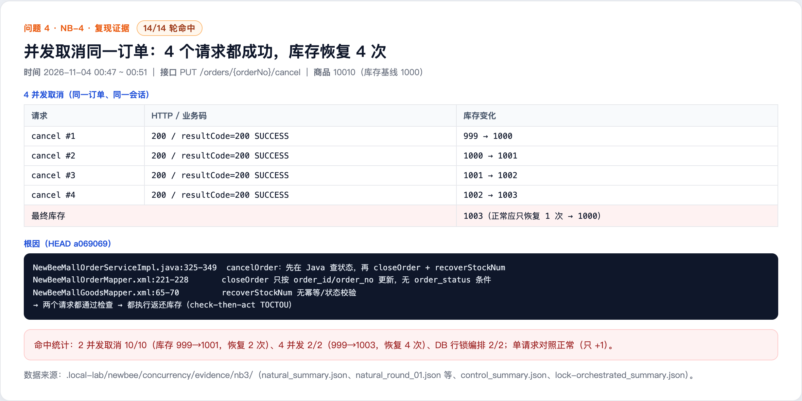

# Concurrent cancellation restores stock multiple times (NB-4)

## Summary

Order cancellation checks the order status in Java and then closes the order with an SQL statement that only matches the order number. The SQL has no current-status condition and always reports success; stock is restored unconditionally afterwards. Concurrent cancellation requests for the same order all pass the Java check and all restore stock, causing stock inflation.

- Affected version: newbee-mall main branch a069069 (2025-10-27)
- Endpoint: PUT /orders/{orderNo}/cancel
- Prerequisite: a member and a waiting-for-payment order
- Impact: stock is restored multiple times and can be oversold

## Root Cause

- NewBeeMallOrderServiceImpl.java lines 325-349: cancelOrder checks the status in Java and then calls closeOrder and recoverStockNum; the status transition and stock recovery are not atomic.
- NewBeeMallOrderMapper.xml lines 221-228: closeOrder updates only by order_id/order_no, without a current-status condition, and does not check the affected row count.
- NewBeeMallGoodsMapper.xml lines 65-70: recoverStockNum has no idempotency or status check, so any caller can restore stock.

Code references (a069069):

- https://github.com/newbee-ltd/newbee-mall/blob/a069069/src/main/java/ltd/newbee/mall/service/impl/NewBeeMallOrderServiceImpl.java#L325-L349
- https://github.com/newbee-ltd/newbee-mall/blob/a069069/src/main/resources/mapper/NewBeeMallOrderMapper.xml#L221-L228
- https://github.com/newbee-ltd/newbee-mall/blob/a069069/src/main/resources/mapper/NewBeeMallGoodsMapper.xml#L65-L70

## Reproduction

1. A member creates a waiting-for-payment order (goods 10010, quantity 1, stock baseline 1000).
2. Send multiple PUT /orders/{orderNo}/cancel requests for the same order almost simultaneously (the same session is sufficient; 4 concurrent requests were tested).
3. All 4 requests return HTTP 200 and resultCode=200 SUCCESS; stock is restored from 999 to 1003 (correct behavior would restore once to 1000).
4. Hit statistics: 2 concurrent cancellations 10/10 (stock 999 -> 1001, restored twice), 4 concurrent 2/2 (999 -> 1003, restored four times), database row-lock orchestration 2/2; a single request correctly restores once.

## Observed Result

Concurrent cancellation restored stock multiple times and overselling is confirmed (14/14 attempts).

## Impact

- Stock is restored more than once, causing overselling; combined with NB-3 the stock distortion becomes worse.
- Order status and stock are inconsistent, affecting fulfilment, refunds and reconciliation.

## Remediation

- Add a current-status condition (for example order_status = waiting for payment) to closeOrder and check the affected row count; only the request that actually updates the order may restore stock.
- Use database optimistic locking, a row lock or a state machine to make the status transition and stock restoration atomic.
- Add idempotency control to recoverStockNum (record per order whether stock has already been restored).

## References

- Fix status: pending vendor fix
- Report: this directory

