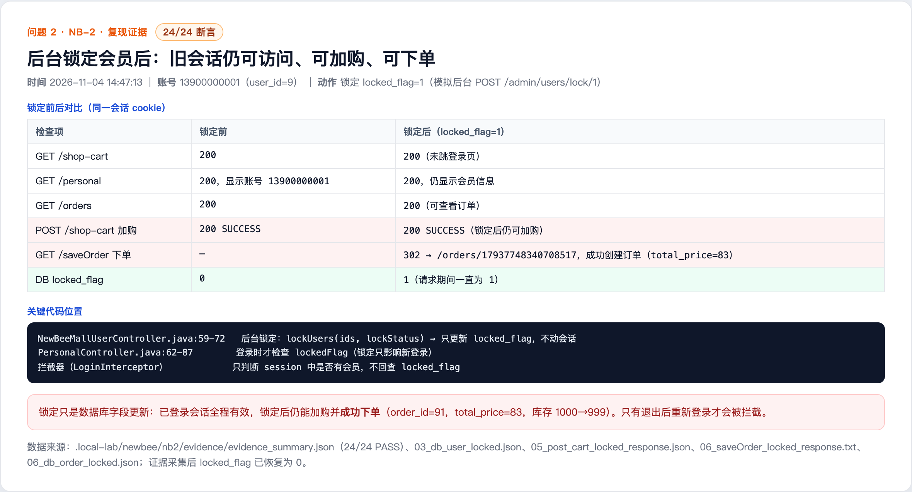

# Locking a member does not invalidate the existing session (NB-2)

## Summary

The admin lock operation only sets locked_flag=1 in the database; it does not invalidate sessions that are already logged in. The login interceptor checks whether the session contains a member but does not re-check locked_flag. A locked member can therefore continue to browse, add items to the cart and place orders until the session expires.

- Affected version: newbee-mall main branch a069069 (2025-10-27)
- Endpoint: admin lock API and any authenticated member API
- Prerequisite: a member with an active session
- Impact: the account lock is not effective for existing sessions

## Root Cause

- NewBeeMallUserController.java lines 59-72: the admin lock endpoint /admin/users/lock/{lockStatus} calls lockUsers(ids, lockStatus), which only updates locked_flag.
- NewBeeMallUserServiceImpl.lockUsers lines 100-106 only executes lockUserBatch to update the database; it does not delete or invalidate the user's session.
- PersonalController.java lines 62-87 checks lockedFlag only during login; the login interceptor only checks whether a member exists in the session and does not re-check locked_flag.

Code references (a069069):

- https://github.com/newbee-ltd/newbee-mall/blob/a069069/src/main/java/ltd/newbee/mall/controller/admin/NewBeeMallUserController.java#L59-L72
- https://github.com/newbee-ltd/newbee-mall/blob/a069069/src/main/java/ltd/newbee/mall/service/impl/NewBeeMallUserServiceImpl.java#L100-L106
- https://github.com/newbee-ltd/newbee-mall/blob/a069069/src/main/java/ltd/newbee/mall/controller/mall/PersonalController.java#L62-L87

## Reproduction

1. Log in as member 13900000001 and obtain a valid session cookie. Baseline: GET /shop-cart, GET /personal and GET /orders all return 200.
2. Lock the member (equivalent to POST /admin/users/lock/1): UPDATE tb_newbee_mall_user SET locked_flag=1 WHERE user_id=9.
3. Reuse the same session cookie: GET /shop-cart, GET /personal and GET /orders still return 200 and the personal page still shows the member information.
4. Confirm that write operations are possible: POST /shop-cart still adds an item, and GET /saveOrder creates order_no=17937748340708517 (order_id=91, total_price=83, stock 1000 -> 999).
5. After collecting evidence, set locked_flag back to 0; the session remains valid.

## Observed Result

During the lock period the database locked_flag was 1, but the old session was not invalidated. The member could browse, add items to the cart and place an order. All 24 checks in the test passed.

## Impact

- A locked member can continue to place orders and perform other operations until the session expires, so the lock action is ineffective.
- Account-lock based risk control and banning are weakened.

## Remediation

- On lock, delete or invalidate all sessions of the member (for example, clear sessions by userId or use a token/session store with revocation).
- Check locked_flag in the login interceptor and reject and clear sessions of locked members.
- Re-check the current lock status on critical write operations such as order creation and payment.

## References

- Fix status: pending vendor fix
- Report: this directory

