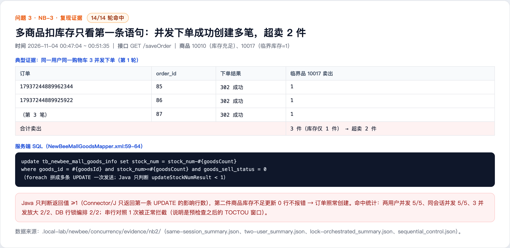

# Multi-item stock deduction only checks one statement result and oversells (NB-3)

## Summary

The order stock deduction SQL is built with a foreach loop into multiple UPDATE statements, and the JDBC URL enables allowMultiQueries=true so all statements are sent at once. The code only checks whether the return value is >= 1. When multiple statements run, the driver typically reports only the affected row count of the first statement, so a later item that updates 0 rows because of insufficient stock is not detected and the order is still created. Concurrent orders can therefore oversell low-stock items.

- Affected version: newbee-mall main branch a069069 (2025-10-27)
- Endpoint: GET /saveOrder
- Prerequisite: a member with a cart containing multiple items and a low-stock item
- Impact: overselling

## Root Cause

- application.properties line 10: the JDBC URL contains allowMultiQueries=true, so multiple UPDATE statements are sent in one call.
- NewBeeMallGoodsMapper.xml lines 59-64: updateStockNum uses foreach to build multiple UPDATE statements, each with stock_num >= quantity.
- NewBeeMallOrderServiceImpl.java lines 215-218 only checks updateStockNumResult < 1. Connector/J returns only the first statement's affected rows, so a second item that updates 0 rows does not cause an error and the order continues.
- Additionally, ShoppingCartItemMapper.xml lines 46-52 deleteBatch has no is_deleted=0 condition, which contributes to multiple orders being created from the same cart concurrently.

Code references (a069069):

- https://github.com/newbee-ltd/newbee-mall/blob/a069069/src/main/resources/application.properties#L10
- https://github.com/newbee-ltd/newbee-mall/blob/a069069/src/main/resources/mapper/NewBeeMallGoodsMapper.xml#L59-L64
- https://github.com/newbee-ltd/newbee-mall/blob/a069069/src/main/java/ltd/newbee/mall/service/impl/NewBeeMallOrderServiceImpl.java#L207-L220
- https://github.com/newbee-ltd/newbee-mall/blob/a069069/src/main/resources/mapper/ShoppingCartItemMapper.xml#L46-L52

## Reproduction

1. Put two items in the member cart: 10010 (abundant stock, used to create a multi-item order) and 10017 (critical stock, for example 1 unit).
2. Send GET /saveOrder for the same cart almost simultaneously from the same session or two users (thread barrier).
3. Multiple attempts succeeded locally (14/14): two users concurrent 5/5, same session concurrent 5/5, three-way amplification 2/2, database row-lock orchestration 2/2.
4. Typical round: the same user and cart with 3 concurrent requests create 3 orders (order_id 85/86/87). Item 10017 has only 1 unit and only 1 unit is deducted, but each of the 3 orders sells 1 unit, so 2 units are oversold.
5. Control: serial orders are correctly rejected by the pre-check with an insufficient stock error, so the race window is a TOCTOU after the pre-check and before stock deduction.

## Observed Result

Concurrent order creation produced more orders than the available stock, so overselling is confirmed (14/14 attempts).

## Impact

- Items with insufficient stock can still be ordered, causing overselling and fulfilment problems.
- Combined with order, payment and refund flows, it can cause financial loss and statistics distortion.

## Remediation

- Execute stock deduction item by item and check the affected row count of every UPDATE; throw an exception and roll back the order when any update affects 0 rows.
- Do not send multiple stock UPDATE statements through allowMultiQueries; use a single conditional batch update and check each result.
- Add is_deleted=0 to deleteBatch and add idempotency or a row lock for concurrent submissions of the same cart.

## References

- Fix status: pending vendor fix
- Report: this directory

