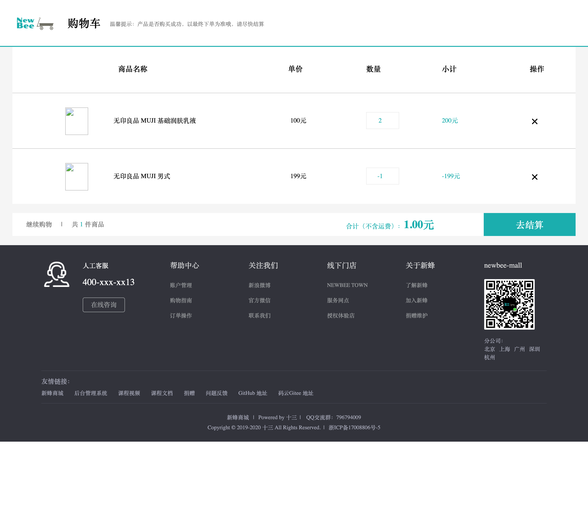
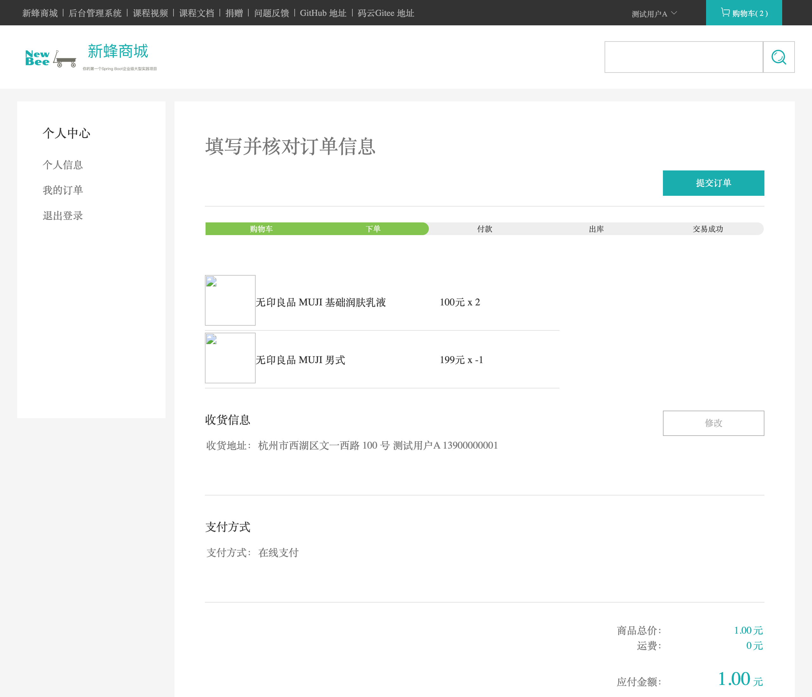
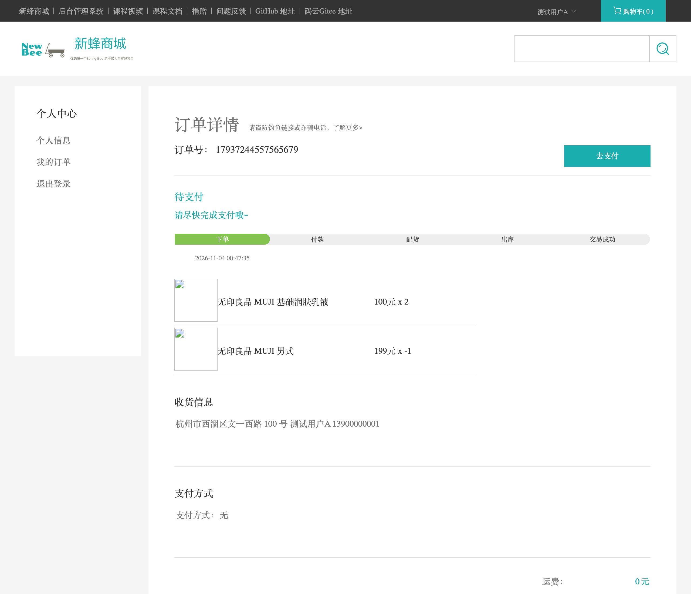
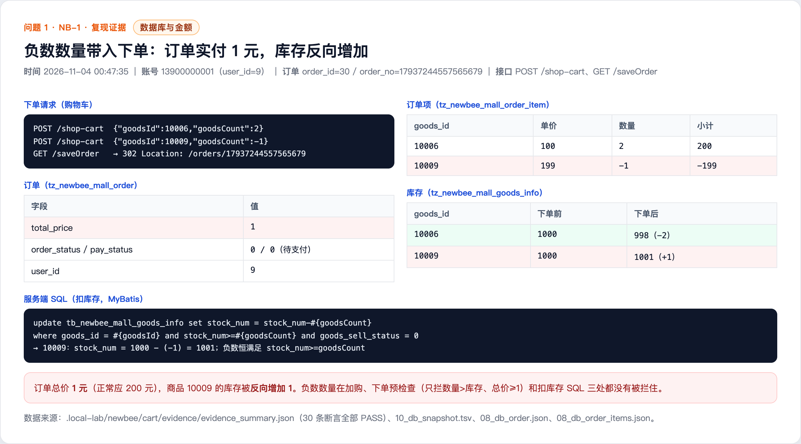

# Negative cart quantity offsets the order amount and increases stock (NB-1)

## Summary

The shopping cart and order flow do not validate that the item quantity is positive. A member can add an item with a negative quantity, and the negative subtotal offsets the amount of other items. The stock deduction SQL then subtracts a negative number, which increases the stock of the offset item. The order total can be reduced to 1 CNY while the goods are worth 200 CNY, and the stock of the offset item is inflated.

- Affected version: newbee-mall main branch a069069 (2025-10-27)
- Endpoints: POST /shop-cart and GET /saveOrder
- Prerequisite: a normal member account
- Impact: price manipulation and stock inflation

## Root Cause

- Adding to the cart and changing the quantity only enforce an upper bound: NewBeeMallShoppingCartServiceImpl.java lines 52 and 73 check goodsCount > 5, but there is no goodsCount >= 1 check. Line 185 writes a negative quantity into the cart unchanged.
- The order pre-check only rejects quantity > stock: NewBeeMallOrderServiceImpl.java line 207 checks whether the quantity is greater than the stock, so -1 > 1000 is false and a negative value passes.
- The price fallback only checks the total: NewBeeMallOrderServiceImpl.java lines 228-233 require priceTotal >= 1. In the reproduced order, 100 * 2 + 199 * (-1) = 1, which passes.
- The stock SQL does not handle negative values: NewBeeMallGoodsMapper.xml lines 59-64 use stock_num = stock_num - #{goodsCount} with the condition stock_num >= #{goodsCount}. For a negative value this becomes stock_num - (-1) = stock_num + 1, and the condition is always true.
- The cart page (cart.html lines 124-140) has a client-side check for quantity < 1, but calling the API directly bypasses it.

Code references (a069069):

- https://github.com/newbee-ltd/newbee-mall/blob/a069069/src/main/java/ltd/newbee/mall/controller/mall/ShoppingCartController.java#L63-L90
- https://github.com/newbee-ltd/newbee-mall/blob/a069069/src/main/java/ltd/newbee/mall/service/impl/NewBeeMallShoppingCartServiceImpl.java#L38-L88
- https://github.com/newbee-ltd/newbee-mall/blob/a069069/src/main/java/ltd/newbee/mall/service/impl/NewBeeMallOrderServiceImpl.java#L200-L234
- https://github.com/newbee-ltd/newbee-mall/blob/a069069/src/main/resources/mapper/NewBeeMallGoodsMapper.xml#L59-L64

## Reproduction

1. Log in as member 13900000001 (local test account) with an existing address.
2. Add goods 10006 (MUJI basic lotion, price 100) with quantity 2: POST /shop-cart {"goodsId":10006,"goodsCount":2}.
3. Add goods 10009 (MUJI men's item, price 199) with quantity -1: POST /shop-cart {"goodsId":10009,"goodsCount":-1}. The API returns 200 SUCCESS and accepts the negative quantity.
4. Open GET /shop-cart: the quantity input shows -1, the subtotal is -199 CNY and the total is 1.00 CNY.
5. Visit GET /saveOrder to create the order (302 to /orders/{orderNo}); order_no=17937244557565679 (order_id=30), total 1 CNY.
6. Database: order items are 10006 x 2 and 10009 x (-1); stock of 10006 goes from 1000 to 998 (normal deduction), stock of 10009 goes from 1000 to 1001 (reverse increase of 1).

## Observed Result

The negative quantity passed from the cart through order creation: the order total was 1 CNY instead of 200 CNY, and the stock of goods 10009 increased by 1.

The server SQL log (MyBatis DEBUG) shows: update tb_newbee_mall_goods_info set stock_num = stock_num - ? where goods_id = ? and stock_num >= ? and goods_sell_status = 0. For goods 10009 the parameter is -1, so the effective change is +1.

## Impact

- With a real payment integration, a member can buy 200 CNY of goods for 1 CNY, causing direct financial loss.
- Stock of the offset item is inflated, so other users can buy stock that does not exist and cause overselling.
- Negative amounts and negative quantities pollute statistics, reconciliation and after-sales data.

## Remediation

- Validate goodsCount >= 1 on the server when adding to the cart or changing the quantity.
- When creating an order, validate each item quantity >= 1 and each item subtotal > 0, and require the total > 0; do not rely only on the total.
- Add a positive-change condition to the stock SQL, or validate that the change is positive in Java.
- Add a database CHECK constraint stock_num >= 0 and centralize stock changes in one service.

## References

- Fix status: pending vendor fix
- Related upstream issue: https://github.com/newbee-ltd/newbee-mall/issues/127
- Report: this directory

