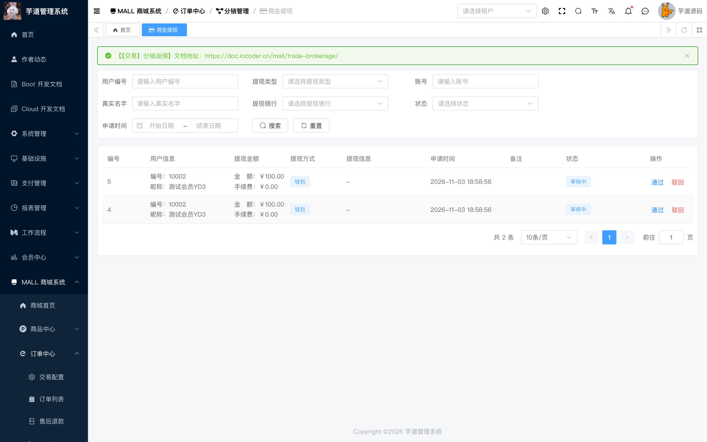
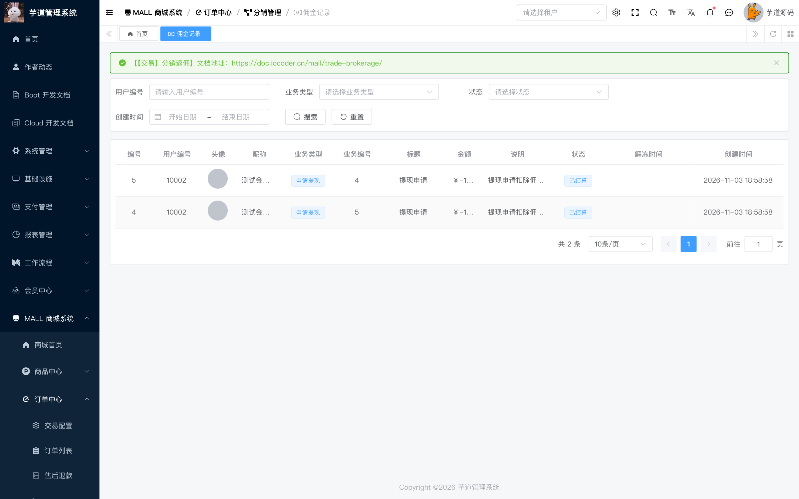

# Concurrent brokerage withdrawal can make the balance negative (YD-3)

## Summary

The brokerage withdrawal flow reads the user's brokerage balance in Java and then executes a deduction SQL statement without an atomic balance lower-bound condition. Two concurrent withdrawal requests can both pass the Java check and both deduct the full amount, leaving the brokerage balance negative and creating more withdrawal orders than the balance allows.

- Affected version: ruoyi-vue-pro master branch before 2026-11-05 (reported at commit c799e27c54)
- Affected endpoint: POST /app-api/trade/brokerage-withdraw/create
- Prerequisite: a distribution user with a brokerage balance
- Impact: the platform overpays commission withdrawals

## Root Cause

- BrokerageRecordServiceImpl reads the brokerage balance in Java and checks whether it is sufficient before calling the deduction SQL.
- BrokerageUserMapper.updatePriceDecr only uses WHERE id = ?, without a balance >= deduction condition, so the update always succeeds.
- The caller checks the affected row count, but the check can never fail; the failure branch is dead code.
- The member point deduction in the same project already added a lower-bound condition in commit b78102a5c6; the brokerage code uses the same pattern but was not fixed.

Code references (c799e27c54):

- https://github.com/YunaiV/ruoyi-vue-pro/blob/c799e27c54/yudao-module-mall/yudao-module-trade/src/main/java/cn/iocoder/yudao/module/trade/service/brokerage/BrokerageRecordServiceImpl.java#L297-L313
- https://github.com/YunaiV/ruoyi-vue-pro/blob/c799e27c54/yudao-module-mall/yudao-module-trade/src/main/java/cn/iocoder/yudao/module/trade/dal/mysql/brokerage/BrokerageUserMapper.java#L56-L70
- https://github.com/YunaiV/ruoyi-vue-pro/blob/c799e27c54/yudao-module-member/src/main/java/cn/iocoder/yudao/module/member/dal/mysql/user/MemberUserMapper.java#L89-L103 (reference: point deduction lower bound)

## Reproduction

1. Set the brokerage balance of member 10002 to 10000 cents (100 CNY) in trade_brokerage_user.
2. Send two POST /app-api/trade/brokerage-withdraw/create requests concurrently, both with the body {"type": 1, "price": 10000}. type=1 means the wallet; price is in cents.
3. Both requests read the balance 10000 and both pass the Java check.
4. Both deduction statements update the row successfully.

## Observed Result

- Two concurrent requests (started about 0.1 ms apart) both returned success: {"code":0,"data":2} and {"code":0,"data":3}; two withdrawal orders (id 2 and 3) were created.
- The balance changed from 10000 to -10000 (-100 CNY).
- Two withdrawal orders of 10000 cents each and two brokerage deduction records of -10000 cents each were created.
- The SQL log shows that both threads read 10000 almost simultaneously, then both executed UPDATE trade_brokerage_user SET brokerage_price = brokerage_price + (-10000) WHERE id = ? and both reported Updates: 1.
- Deterministic verification: an external MySQL transaction locked the row, both requests completed the Java balance check and blocked on the UPDATE, and both updates still succeeded after the lock was released, proving the race window exists.

## Impact

- The withdrawal amount exceeds the actual brokerage balance, and the platform can overpay if the withdrawal is approved.
- Multiple withdrawal orders can be created from the same balance.
- The same pattern may affect other balance-like resources if the deduction SQL lacks a lower-bound condition.

## Remediation

Add a balance lower-bound condition to updatePriceDecr, for example .ge(BrokerageUserDO::getBrokeragePrice, -incrCount), consistent with the member point deduction fix. The caller must check the affected row count: the second withdrawal will update 0 rows and must throw an insufficient balance error and roll back the withdrawal order. A distributed lock or pessimistic lock by userId can be added as an additional safeguard.

## References

- Fix commit: https://github.com/YunaiV/ruoyi-vue-pro/commit/64d68433ed77ccdde6b1652845d2d1efc1d08ca7 (master-jdk17, 2026-11-05)
- Vendor confirmation: https://github.com/MrBrantCode/vul_poc/blob/main/ruoyi-vue-pro_2026.10/Disclosure_Process.md

