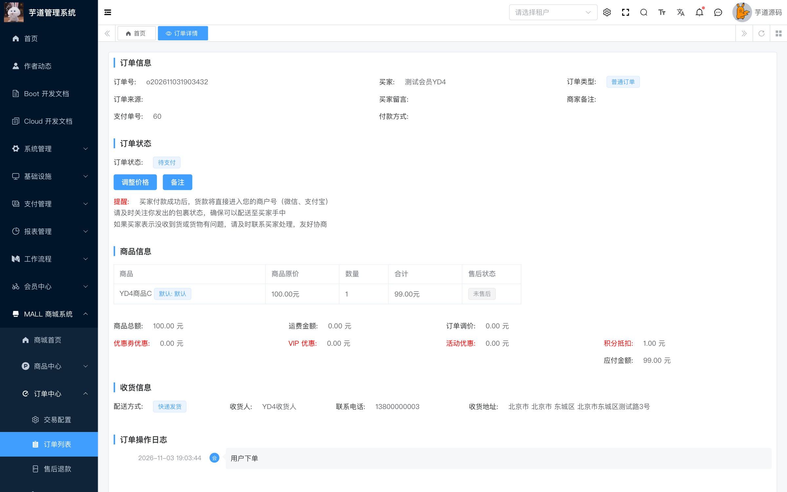
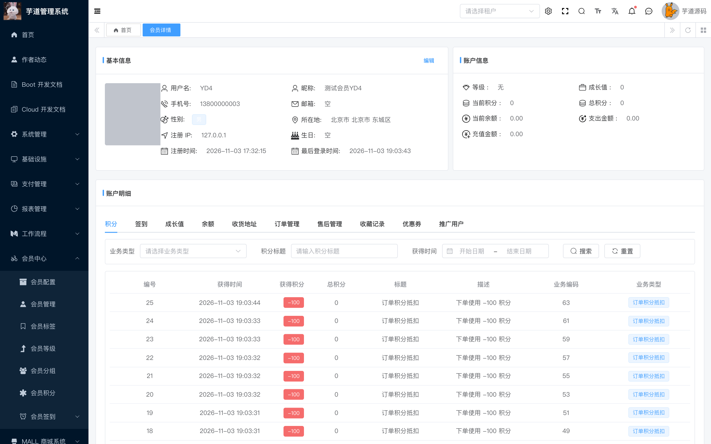

# Concurrent member point deduction can reuse the same points (YD-4)

## Summary

Member points are deducted after the order is created. When the point deduction fails because the member balance is insufficient, MemberPointRecordServiceImpl only logs an error and returns without throwing an exception, so the order transaction is not rolled back. Two concurrent orders can therefore both use the same points, and the second order is created at the discounted price without deducting points.

- Affected version: ruoyi-vue-pro master branch before 2026-11-05 (reported at commit c799e27c54)
- Affected endpoint: POST /app-api/trade/order/create when point deduction is used
- Prerequisite: a member with points; two concurrent orders using point deduction
- Impact: the platform loses the point discount for the second order

## Root Cause

- During price calculation, TradePointUsePriceCalculator reads the current member points and calculates the deduction.
- The points are deducted after order creation in TradeMemberPointOrderHandler#afterOrderCreate.
- MemberPointRecordServiceImpl#createPointRecord reads the balance and, when points are insufficient, only logs an error and returns instead of throwing an exception. The order transaction is not rolled back.
- MemberUserMapper#updatePointDecr already has a point >= deduction lower-bound condition, so concurrent updates that affect 0 rows will throw and roll back. However, the silent-return branch bypasses this protection.

Code references (c799e27c54):

- https://github.com/YunaiV/ruoyi-vue-pro/blob/c799e27c54/yudao-module-mall/yudao-module-trade/src/main/java/cn/iocoder/yudao/module/trade/service/order/handler/TradeMemberPointOrderHandler.java#L35-L39
- https://github.com/YunaiV/ruoyi-vue-pro/blob/c799e27c54/yudao-module-member/src/main/java/cn/iocoder/yudao/module/member/service/point/MemberPointRecordServiceImpl.java#L66-L95
- https://github.com/YunaiV/ruoyi-vue-pro/blob/c799e27c54/yudao-module-member/src/main/java/cn/iocoder/yudao/module/member/dal/mysql/user/MemberUserMapper.java#L89-L103

## Reproduction

1. Set the member points to 100 and the SKU price to 10000 cents (100 CNY). Configure point deduction as 1 point = 1 cent.
2. Submit two orders concurrently with the same request body:

    POST /app-api/trade/order/create
    Content-Type: application/json
    Authorization: Bearer <member token>

    {
      "items": [{"skuId": 3, "count": 1}],
      "pointStatus": true,
      "deliveryType": 1,
      "addressId": 10003
    }

3. Both orders are created at the discounted price of 9900 cents, while the points are deducted only once.

## Observed Result

- Both concurrent requests returned code=0 and created orders 63 and 64.
- Both orders have total_price=10000, pay_price=9900, use_point=100 and point_price=100.
- The member points changed from 100 to 0, but member_point_record contains only one deduction record (biz_id=63, -100). Order 64 was created without deducting points.
- The server log shows the silent branch: MemberPointRecordServiceImpl:77 [createPointRecord][userId(10003) point(-100) bizType(ORDER_USE) bizId(64) insufficient member points].
- Additional experiment: 5 concurrent requests over 3 rounds; in each round all 5 orders were created at the discounted price, while only one point deduction record was written per round.

## Isolation Level Note

Under MySQL REPEATABLE-READ (the default), the second transaction updates 0 rows in UPDATE member_user ... WHERE point >= 100 and rolls back with an insufficient points error. The described chain (price calculation reads 100, deduction check reads 0, only logs and returns, order is not rolled back) was reproduced under READ-COMMITTED, which is common for managed databases or can be configured. The root cause is the silent return that prevents the transaction from rolling back, independent of the isolation level.

## Impact

- The same points can be used by multiple orders, so the platform loses the point discount.
- The order is created at the discounted price while the points are not deducted, breaking the points ledger.
- The issue can be repeated with concurrent requests.

## Remediation

1. Throw a business exception (USER_POINT_NOT_ENOUGH) in MemberPointRecordServiceImpl#createPointRecord when points are insufficient, so the order transaction rolls back instead of only logging.
2. Deduct points and create the order in the same transaction, either deducting first with a lower-bound condition and then creating the order, or explicitly rolling back the order when the deduction fails.
3. Use a consistent snapshot for price calculation and deduction, or add a unique idempotency key for order point deductions.

## References

- Fix commit: https://github.com/YunaiV/ruoyi-vue-pro/commit/64d68433ed77ccdde6b1652845d2d1efc1d08ca7 (master-jdk17, 2026-11-05)
- Vendor confirmation: https://github.com/MrBrantCode/vul_poc/blob/main/ruoyi-vue-pro_2026.10/Disclosure_Process.md

